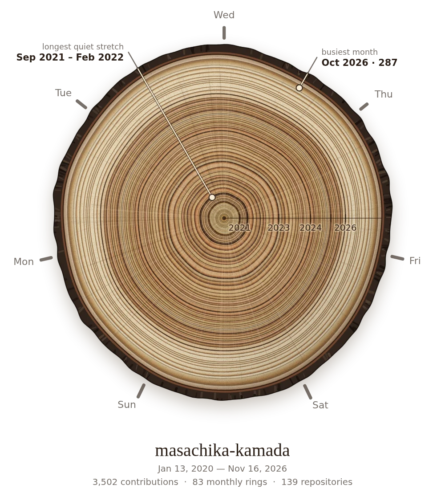

<!-- ~2022-12-12

-->

<!-- heartwood:start -->

  <a href="https://masachika-kamada.github.io/heartwood/#masachika-kamada">
    <picture>
      <source media="(prefers-color-scheme: dark)" srcset="heartwood/heartwood-dark.webp">
      
    </picture>
  </a>
   
  
   
  Busiest year: 2026 · Leans toward Saturdays · Last 12 months: 7.1× the 12 before
   
  My GitHub history, drawn as the growth rings of a tree · made with <a href="https://github.com/masachika-kamada/heartwood">Heartwood</a>
   
  Rest the pointer on a band to read that ring. Click it to open that ring.

<!-- heartwood:end -->

 
 

